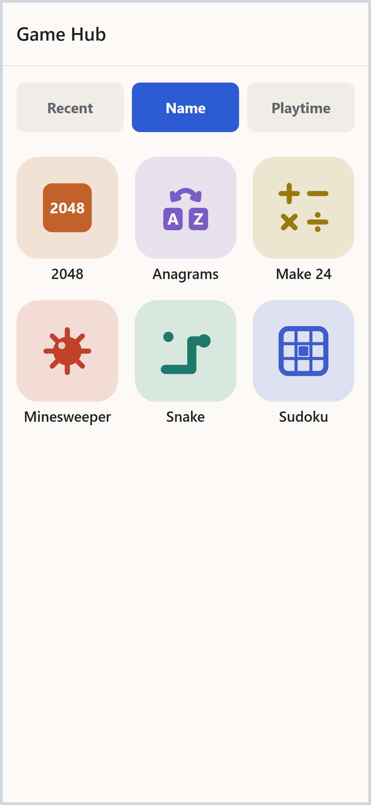
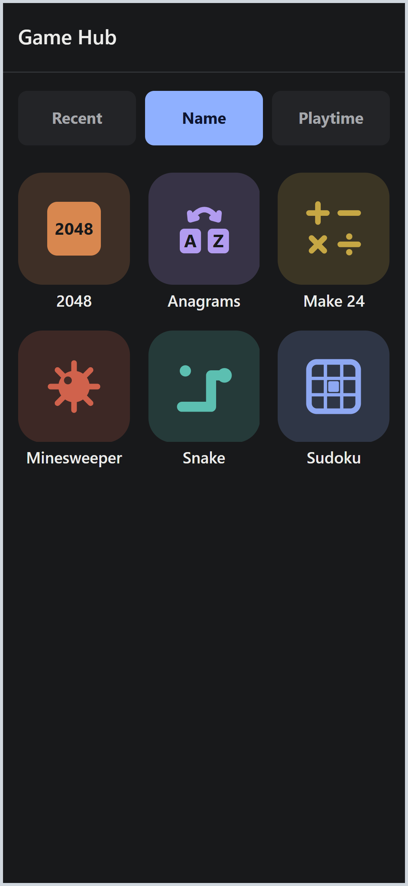
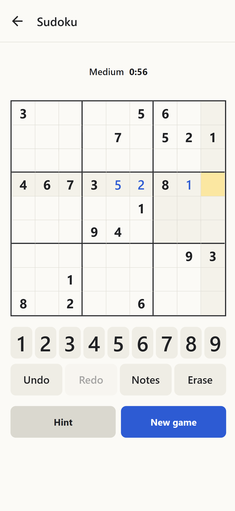
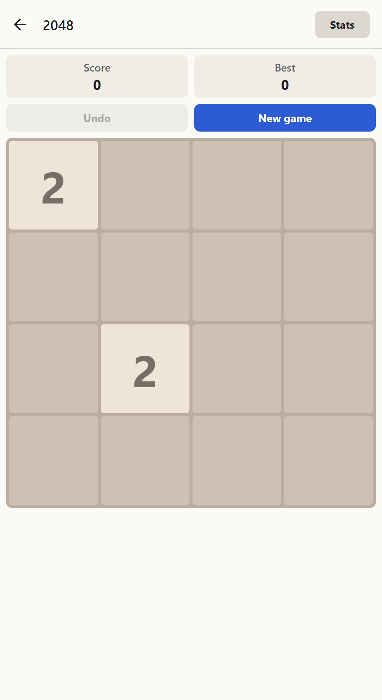
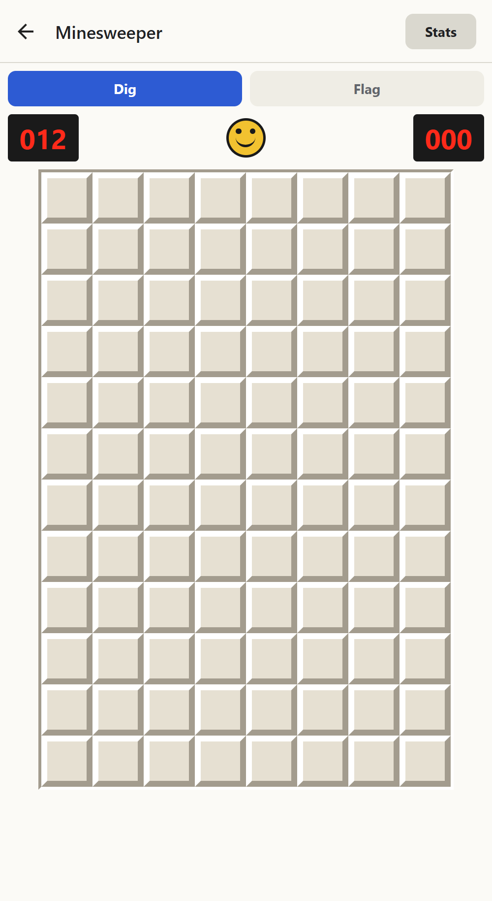
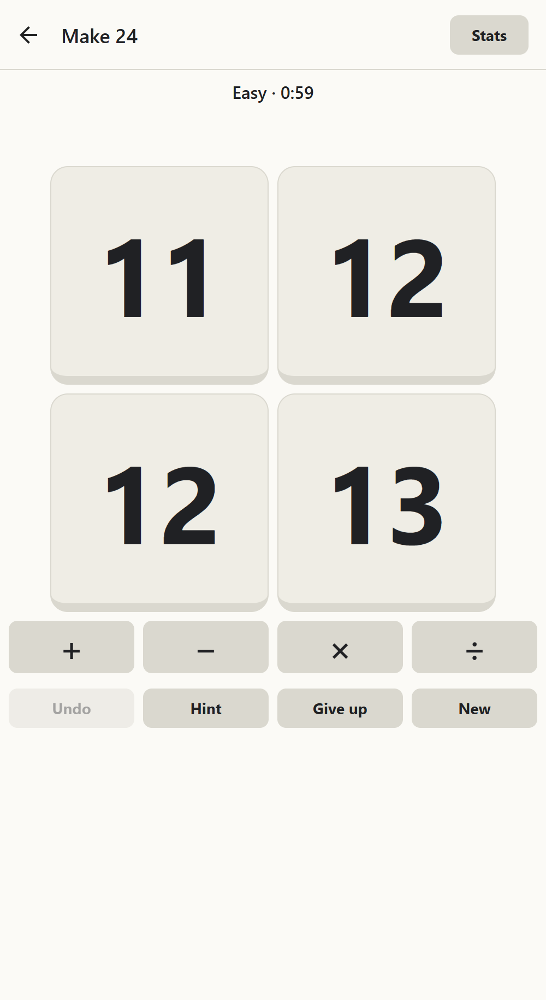
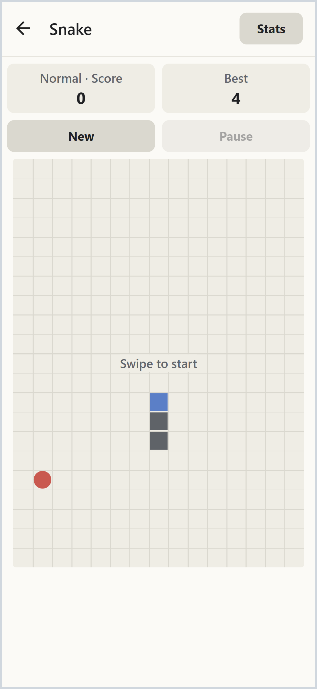
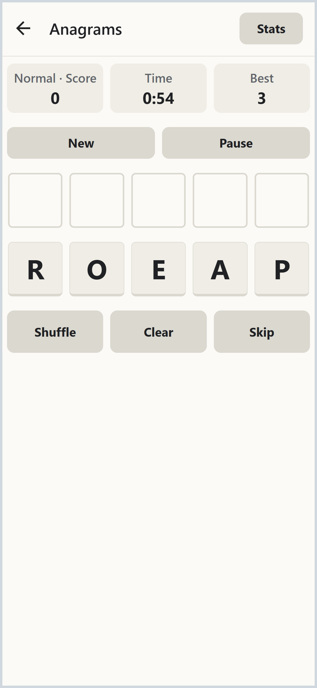

# Game Hub

Fully vibe-coded hub of simple games for Android built with [Expo](https://expo.dev), [React Native](https://reactnative.dev) and [TypeScript](https://www.typescriptlang.org). It is installed as an APK, and it also runs in the browser. Saved games and stats stay on the device (fully offline, no network needed).

<table>
<tr>
<td align="center" valign="top" width="25%"><b>Hub</b>  Sort the games by Recent, Name or Playtime.</td>
<td align="center" valign="top" width="25%"><b>Hub (dark)</b>  Light and dark mode follow the system.</td>
<td align="center" valign="top" width="25%"><b>Sudoku</b>  Five difficulty levels, notes, hints, undo and redo.</td>
<td align="center" valign="top" width="25%"><b>2048</b>  Boards from 4×4 to 7×7, swipe to play.</td>
</tr>
<tr>
<td align="center" valign="top" width="25%"><b>Minesweeper</b>  Three levels, flags.</td>
<td align="center" valign="top" width="25%"><b>Make 24</b>  Combine four numbers with + − × ÷ to make 24.</td>
<td align="center" valign="top" width="25%"><b>Snake</b>  Swipe to turn, walls kill.</td>
<td align="center" valign="top" width="25%"><b>Anagrams</b>  Unscramble as many words as you can in 60 seconds.</td>
</tr>
</table>

## Features

- **Hub main menu**: a grid of game tiles. Sort it by Recent, Name or Playtime; the app remembers your choice.
- **Independent games**: each game saves its game in progress and keeps its own stats.
- **Playtime**: the hub counts how long each game is open while the app is in front, for the Playtime sort.
- **Light and dark mode** follow the system setting.

## How it was developed with Claude Code

The project was built with [Claude Code](https://claude.com/claude-code); the rules it works by are in `CLAUDE.md`, and each game has its spec, decisions and milestones in `docs/<game>.md`.

- Every milestone starts in plan mode. The plan is approved before any code is written, and any decision with trade-offs goes back to the human.
- The main Claude Code session only orchestrates. The work is done by separate Claude Code agents, each in its own visible [Herdr](https://herdr.dev) pane with a brief file, a list of files it may edit and a fixed reply line. Read-only helpers may work in-pane.
- A review pane with [ponytail](https://github.com/DietrichGebert/ponytail) looks for over-engineering: the laziest version that passes the checks.
- [graphify](https://github.com/Graphify-Labs/graphify) keeps a knowledge graph of the code and docs for orientation.
- The check is written first, then the code. Game rules are unit-tested with [Jest](https://jestjs.io), and screens are tested by opening the real routes.
- The gate (`npm run gate`) runs before every hand-off: type check, Jest tests, [ESLint](https://eslint.org) with [Prettier](https://prettier.io) for formatting, and [gitleaks](https://github.com/gitleaks/gitleaks) on the staged files. It also runs as the git pre-commit hook, so a commit with a failing check is refused.
- The change is tried in the browser before each commit. Commits are local, and pushing is done by hand.

## Run it in the browser

1. `npm install` (once, optionally run tests with `npm test`)
2. `npx expo start`, then press `w`

## Run it on Android (Pick one option)

- **Install the release APK**: download it from the Releases page, open it on the phone, and allow "Install unknown apps" when asked.
- **Build the APK in the cloud** with [EAS](https://expo.dev/eas) (free Expo account): after `npm install`, run `npx eas-cli@latest build -p android --profile preview`. EAS gives a download link; install the APK like the release one.
- **Build and run it locally**: needs [Android Studio](https://developer.android.com/studio) with the Android SDK, and a phone over USB (developer mode, USB debugging) or an emulator. After `npm install`, `npx expo run:android` builds and starts the app.

## License

MIT, see [LICENSE](LICENSE). Anagrams takes its words from [SCOWL](https://wordlist.aspell.net/other) (Spell Checker Oriented Word Lists), a free collection of English word lists made for spell checkers; its licence notice is in `src/games/anagram/data/SCOWL-LICENSE.txt`.
